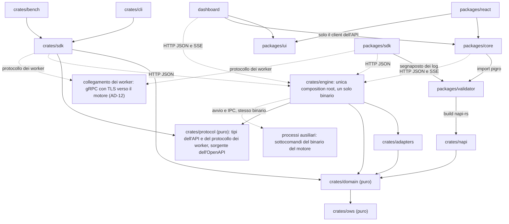
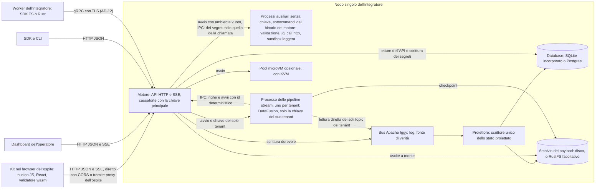
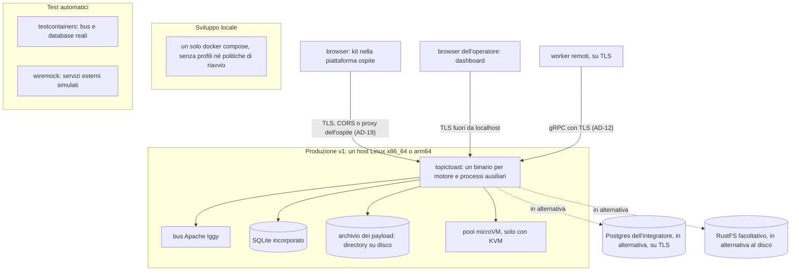

# Architecture Spine — topictoast

## Design Paradigm

**Hexagonal** (porte e adattatori, costituzione III) con una sola composition root. Il log del
bus è la fonte di verità; il database è una proiezione (AD-2).

| Strato | Dove | Contiene |
| --- | --- | --- |
| Modello OWS | `crates/ows` | tipi del sottoinsieme OWS 1.1 supportato + task `dag`, lettura e scrittura del documento, forma canonica. Puro, compila per `wasm32-wasip1`; nessuna dipendenza dal resto del workspace (AD-15) |
| Dominio | `crates/domain` | modello OWS da `crates/ows`, validatore, linguaggio degli schemi, stati e regola di propagazione, porte. Puro: niente I/O né runtime async; compila anche per `wasm32-wasip1` (AD-11) |
| Tipi dell'API | `crates/protocol` | tipi dell'API pubblica e del protocollo dei worker, sorgente dello schema OpenAPI. Puro, senza I/O; nessuna dipendenza dal resto del workspace; lo usano motore e SDK Rust (AD-15) |
| Adattatori | `crates/adapters` | bus, repository (SQLite e Postgres), archivio dei payload (disco e RustFS), cassaforte, collegamento dei worker, modulo del client HTTP del motore |
| Composition root | `crates/engine` | binario del motore: API, proiettore, processi ausiliari come sottocomandi; unico punto che sceglie gli adattatori (AD-16) |
| Processi ausiliari | sottocomandi del binario di `crates/engine`; quali separare lo fissa S-2 (M-28) | contenuto dei tenant: validazione, jq, `call http`, sandbox leggera, pipeline stream con un processo per tenant (AD-6, AD-13) |
| Client Rust | `crates/sdk`, `crates/cli`, `crates/napi`, `crates/bench` | SDK, CLI sull'SDK, collegamento napi-rs del validatore, benchmark (FR-53) |
| Client JS | `packages/ui`, `packages/validator`, `packages/core`, `packages/react`, `packages/sdk` | design system condiviso, output di napi-rs, nucleo JS e client dell'API, componenti React del kit, SDK TS |
| Dashboard | `dashboard/` | interfaccia dell'operatore su `packages/ui` e sul client dell'API di `packages/core` (skill `dashboard-react`) |

Nomi dei crate e dei pacchetti fissati: regole, `purity.rs` e gate li citano.

## Invariants & Rules

### AD-1 — Unità di runtime della v1 [ADOPTED]

- **Binds:** FR-12, FR-16, FR-50, FR-54, NFR-1, NFR-15; motore, bus, database, processi ausiliari, worker.
- **Prevents:** unità che aggiungono servizi da installare o processi non gestiti dal motore.
- **Rule:** un motore Rust a nodo singolo, senza HA del centro nella v1, che riparte da solo entro
  30 s (NFR-15). Il bus è Apache Iggy, un servizio separato a nodo singolo (ADR del bus). Database:
  SQLite incorporato oppure Postgres, a scelta dell'integratore. Ogni altro processo di topictoast
  (sandbox leggera, processi ausiliari, pool microVM opzionale dove c'è KVM) lo avvia e lo ferma il
  motore. I worker sono processi dell'integratore sempre attivi, anche remoti, che registrano
  funzioni con manifest e si collegano solo al motore, su gRPC con TLS (AD-12): mai al bus.
  L'installazione predefinita non chiede Kubernetes, KVM né root e ascolta solo su localhost. I
  worker scalano in orizzontale; motore e bus in verticale fino a NFR-3.

### AD-2 — Verità sul log del bus, database come proiezione [ADOPTED]

- **Binds:** FR-8, FR-9, FR-10, FR-32, FR-41, FR-48, FR-51, NFR-2, NFR-4, NFR-6, NFR-15, SM-2; motore, proiettore, API e dashboard che leggono il database, sentinella del bus.
- **Prevents:** due verità; unità che scrivono lo stato nel database in modo sincrono; lavoro accettato perso per ritardo della proiezione o per un evento saltato; due motori sugli stessi bus e database; due scrittori che si bloccano sul file di SQLite; una consegna partita prima della decisione durevole che la causa; un annullamento confermato prima di essere durevole; due eventi terminali validi sulla stessa esecuzione; contenuto dei tenant in chiaro sul bus.
- **Rule:** «accettato» (FR-9) = scrittura durevole sul log del bus prima della risposta. Il
  database è una proiezione dello stato, scritta a gruppi da un solo scrittore (il proiettore);
  nessun'altra unità scrive lo stato proiettato. La proiezione è idempotente per chiave
  dell'entità (esecuzione, attività, tentativo), mai per posizione del bus. La ripresa (NFR-15)
  parte dall'ultima posizione del bus applicata nel database e rilegge il bus da lì. Sul bus gli
  eventi di stato li scrive solo il motore: i messaggi dei worker sono richieste che il motore
  giudica. Un solo motore per installazione: all'avvio prende un lock esclusivo prima di scrivere
  su bus o database, e un secondo motore esce con un codice. Il proiettore scrive solo quando ha
  qualcosa da applicare (SM-2).
  - **Ritardo.** L'obiettivo è la proiezione indietro al massimo di 1 s. Il database è lento quando
    le transazioni del proiettore riescono in ritardo, fermo quando falliscono. Con il database
    lento il motore continua ad accettare e oltre 1 s avvisa l'operatore (FR-48); le letture dopo
    una scrittura seguono AD-18. Con il database fermo o il disco pieno il motore smette di
    accettare lavoro nuovo e lo rifiuta con un codice (C-7) e un avviso all'operatore: il lavoro
    accettato non si perde mai. Con il disco dei dati del bus pieno il bus si ferma (fail-stop) e
    il motore rifiuta con il codice del bus giù. Un evento che il proiettore non riesce ad
    applicare è un guasto, non un dato: il proiettore si ferma su quella posizione, senza saltarla,
    e il motore rifiuta il lavoro nuovo come sopra. I codici di rifiuto (database fermo, disco
    pieno, bus giù, generazione sbagliata) stanno nel catalogo di C-7 con nomi a punti; i nomi
    `E_*` dell'ADR sono del prototipo.
  - **Scritture del motore nel database.** Segreti e chiavi avvolte dei tenant non passano dal bus
    (C-12): li scrive il motore tramite l'adattatore del repository, prima della risposta, e
    puntano solo a righe che il motore stesso scrive, mai a righe della proiezione (un test sullo
    schema fallisce se una chiave esterna di una tabella del motore punta a una tabella della
    proiezione). Con SQLite c'è una sola corsia di scrittura per processo: proiettore e scritture
    del motore passano dallo stesso mutex.
  - **Un solo punto di decisione per esecuzione.** Comandi, timer ed esiti dei worker di
    un'esecuzione passano da un solo punto del motore, che controlla lo stato e scrive l'evento in
    serie. Il primo evento terminale sul log (conclusa, fallita, annullata, scaduta) vince e i
    successivi si rifiutano; la proiezione deriva lo stato dall'ordine del log, mai dall'ora.
  - **Consegna.** Una consegna, l'avvio di un ausiliario o un evento partono solo dopo il gruppo
    durevole che li causa (`Ready`, o il timer che ha rimesso in coda l'attività). L'evento della
    scadenza del tentativo si scrive subito dopo l'invio, senza attenderlo, nella coda di scrittura
    dell'esecuzione: le code sono FIFO per esecuzione, quindi la scadenza precede l'esito. Un crash
    prima che la scadenza sia durevole fa riconsegnare l'attività con lo stesso `attemptId`
    (C-2): è un doppione contato, mai una perdita.
  - **Timer.** Scadenze dei tentativi, attese tra i tentativi, `wait` e scadenza dell'esecuzione
    sono eventi sul log, al più uno per attività più quello dell'esecuzione. Il motore li arma in
    memoria quando scrive l'evento che li causa; la tabella della proiezione serve solo alla
    ripresa, che li ricostruisce dalle righe più il bus riletto. La scadenza dell'esecuzione
    (FR-8) parte dall'accettazione.
  - **Annullamento (FR-10).** Il comando diventa un evento durevole; solo dopo il motore risponde,
    scarta i passi in attesa, manda lo `Stop` ai worker (AD-12) e annulla i timer. Un esito che
    arriva dopo si rifiuta. Dopo un crash del motore tra l'evento e lo `Stop` lo stop è al meglio:
    il worker può finire il tentativo, e il suo esito si rifiuta.
  - **Forma sul bus.** Per ogni tenant un topic di stato e uno dei log (`state-` e `log-` più
    l'identificativo interno, AD-5), una partizione ciascuno, con la durabilità per messaggio di
    Iggy (`Persisted`); lo spegnimento improvviso dell'host è argomentato, non misurato. Solo la
    credenziale del motore scrive sui topic di stato. Ogni evento di stato porta un'intestazione in
    chiaro con un elenco chiuso di campi: tipo dell'evento, identificativo dell'esecuzione, indice
    del passo, numero del tentativo, scadenza. Mai nomi scelti da un tenant o dall'integratore; un
    test fallisce se compare un altro campo. È l'unica eccezione alla cifratura di C-13. Un
    processo senza chiavi può seguirla in sola lettura (sentinella, ADR del bus).
  - **Generazione e aggiornamento del bus (FR-51).** La generazione del bus sta in un topic proprio
    e nella posizione applicata; un motore con una generazione diversa da quella del bus non parte,
    con un codice. Aggiornare il bus = drain fino alla proiezione allineata, bus nuovo e vuoto,
    riversamento dal database, generazione nuova; pausa entro 30 s.
  - **Conservazione.** Il bus non elimina mai posizioni dei topic di stato non ancora applicate
    dal proiettore: la soglia è la sua posizione, salvata prima di chiedere la cancellazione dei
    segmenti, e nessun altro consumatore la sposta (non provato con il sentinella). I topic degli
    stream seguono la conservazione di FR-18 e il proiettore non li legge.

### AD-3 — Input e output dei task fuori dal database [ADOPTED]

- **Binds:** FR-11, FR-31, NFR-4, SM-2; proiettore, motore (uscite a monte), dashboard, conservazione.
- **Prevents:** JSON nel database; payload scomposti in tabelle ad albero; payload condivisi tra tenant; uscite a monte perse quando il bus scarta le posizioni applicate durante un'esecuzione lunga.
- **Rule:** input e output dei task viaggiano sul bus. Il proiettore scrive ogni payload
  nell'archivio dei payload (AD-17) quando lo applica, non solo per lo storico, indirizzato
  dall'impronta; il database tiene solo un riferimento tipizzato (impronta, dimensione). Le uscite
  a monte si leggono dall'archivio, e finché un payload non è proiettato il motore lo serve dalla
  propria memoria; quindi il bus può scartare le posizioni già applicate anche mentre
  un'esecuzione lunga è viva. L'indirizzo comprende l'identificativo interno del tenant
  (AD-5); nessuna deduplicazione tra tenant. I payload nell'archivio sono cifrati con la chiave
  del tenant (AD-7).

### AD-4 — Costituzione V alla lettera: tutto ciò che il sistema interpreta è tipizzato [ADOPTED]

- **Binds:** FR-5, FR-40, FR-55, FR-56; ogni adattatore di persistenza; documenti OWS, schemi dei manifest, posizioni dei nodi (T-46).
- **Prevents:** JSON opaco nel database.
- **Rule:** documenti OWS, schemi dei manifest e posizioni dei nodi si scompongono in tabelle e
  tabelle figlie tipizzate. Il documento salvato si rigenera dalle tabelle in forma canonica: la
  forma originale non si conserva (FR-40 resta soddisfatto). La forma canonica conserva l'ordine
  dei task in ogni contenitore, `dag` compreso. Ogni cambio della spec OWS accettata è una
  migrazione. Il linguaggio degli schemi (AD-10) si mappa su tabelle di campi.

### AD-5 — Isolamento tra tenant nell'unico adattatore del repository [ADOPTED]

- **Binds:** FR-26, FR-28, FR-29, FR-31, NFR-8; ogni adattatore di persistenza, bus, archivio dei payload, API, eventi in tempo reale, dashboard.
- **Prevents:** query che saltano il filtro del tenant; nomi presi dal JWT in percorsi, nomi di topic o chiavi.
- **Rule:** ogni tenant ha un identificativo interno UUIDv7. Il campo `tenant` del JWT (C-15) è
  un nome esterno che il motore traduce in quell'identificativo; `default` è riservato al tenant
  predefinito. Né i nomi né i valori del JWT finiscono mai in percorsi, nomi di topic o chiavi:
  lì va solo l'identificativo interno. L'integratore è un proprietario con un identificativo
  interno riservato e una propria chiave (AD-7), e segue lo stesso filtro. Ogni accesso al
  database passa da un solo adattatore del repository, che aggiunge sempre il filtro del tenant;
  un test con due tenant copre ogni suo metodo, con SQLite e con Postgres. Con Postgres, in più,
  RLS con un utente dell'applicazione non superuser e senza `BYPASSRLS`, come seconda barriera;
  con SQLite l'adattatore è l'unica (costituzione V, PATCH 1.0.1). Tenant e permessi di una
  richiesta vengono solo dalla credenziale verificata: C-15, sessione dell'operatore o credenziale
  di worker (C-11), ognuna con il proprio ambito. Il tenant predefinito esiste dal primo avvio e
  segue lo stesso percorso. Ogni chiave d'idempotenza, di versione o d'indirizzo comprende
  l'identificativo interno del tenant, e nessun supporto deduplica tra tenant: il test a due
  tenant usa la stessa chiave d'idempotenza e lo stesso modulo. Lo stesso filtro, con il test a
  due tenant, vale per gli eventi in tempo reale (AD-18).

### AD-6 — La chiave sta nel motore, il contenuto dei tenant nei processi ausiliari [ADOPTED]

- **Binds:** FR-13, FR-16, FR-17, FR-25, FR-34, NFR-7, AMB-11; motore, API, processi ausiliari, validatore, sandbox, pipeline stream, `call http`.
- **Prevents:** contenuto ostile che raggiunge la chiave della cassaforte o gli altri tenant.
- **Rule:** il processo del motore custodisce la chiave principale della cassaforte e non
  interpreta mai contenuto scritto dai tenant (documenti, manifest, schemi, jq, `call http`, SQL
  delle pipeline stream). Lo interpretano processi ausiliari (AD-16) che non ricevono mai la
  chiave principale, con limiti di CPU, memoria e tempo; il motore riceve strutture tipizzate e
  passa all'ausiliario solo il segreto della singola chiamata. Unica eccezione: il processo delle
  pipeline stream di un tenant riceve la chiave di quel tenant (AD-13). Le due sandbox e il
  processo delle pipeline stream stanno fuori dal processo del motore; nessuna loro istanza
  contiene mai dati di due tenant, né insieme né in sequenza (FR-16). Le funzioni che
  interpretano contenuto dei tenant (validatore, jq, lettura dei manifest) si chiamano solo
  tramite un permesso che esiste solo in modalità ausiliario; un test prova che la modalità motore
  non le chiama mai. Il motore avvia ogni ausiliario con l'ambiente vuoto e gli passa sull'IPC la
  configurazione risolta e la versione dell'IPC; con una versione diversa l'ausiliario esce. Il
  motore toglie dal proprio ambiente la variabile della chiave principale dopo averla letta.
  Motore e ausiliari non sono ispezionabili (`PR_SET_DUMPABLE` a 0) e non scrivono core dump;
  chiavi e segreti stanno in tipi che si azzerano al rilascio, con `Debug` mascherato. Le risposte
  degli ausiliari sono input esterno (costituzione IV): messaggi tipizzati con tetti di dimensione
  e profondità, validati dal motore. I corpi delle richieste dell'API hanno tetti di dimensione,
  profondità e decompressione, applicati prima dell'analisi. `call http`: nessun archivio di
  cookie né pool di connessioni condiviso tra tenant; `Authorization` non passa mai su un
  redirect verso un'altra origine.

### AD-7 — Cassaforte a busta e dati dei tenant cifrati per tenant [ADOPTED]

- **Binds:** FR-31, FR-32, FR-33, FR-34, NFR-8; motore, bus, database, archivio dei payload, checkpoint delle pipeline stream, nodi caricati, sandbox riservate.
- **Prevents:** segreti in chiaro sul bus; dati di un tenant eliminato ancora leggibili su un supporto; eventi indecifrabili scambiati per eliminati; una chiave principale nuova generata al posto di una mancante; il limite dei nonce di AES-GCM raggiunto su una chiave del tenant; formati di cifratura diversi tra unità.
- **Rule:** chiave principale dell'installazione → una chiave per tenant, cifrata dalla principale
  → segreti in AES-256-GCM (C-12). L'integratore ha una propria chiave, come un tenant (AD-5). I
  segreti si risolvono alla consegna e non entrano mai nei messaggi del bus. Input, output ed
  eventi dei tenant sono cifrati con la chiave del tenant su bus, file e checkpoint. Ogni oggetto
  cifrato porta una busta versionata con l'id della chiave; per ogni oggetto o segmento si deriva
  dalla chiave del tenant, con HKDF, la chiave che lo cifra in AES-256-GCM, e la chiave del tenant
  ruota tramite l'id. Il formato è uno solo, nel dominio, e lo usano motore, proiettore, processo
  delle pipeline stream e archivio dei payload; costo misurato in S-1 (ADR del bus). La chiave principale si
  genera solo con il deposito delle chiavi vuoto; il motore ne conserva l'impronta e, se la chiave
  presente non corrisponde, rifiuta di partire con un codice. Cartelle dei dati 0700 e file 0600; il motore non parte, con un codice, se la
  chiave principale o la cartella dei dati sono leggibili da altri utenti. Eliminare un tenant
  (C-13), in quest'ordine: fermare pipeline stream, esecuzioni, pianificazioni, sandbox riservate
  e stream SSE del tenant, e rifiutarne le richieste → scrivere sul bus l'evento lapide del
  tenant → cancellarne la chiave → cancellarne le righe del database tramite l'adattatore del
  repository e i nodi caricati → pulizia asincrona di bus e archivio dei payload. La rilettura
  del bus salta solo gli eventi dei tenant con lapide; un evento che non si decifra senza lapide è
  un guasto che ferma proiettore e ripresa (AD-2), mai un'eliminazione. Cancellazione senza
  residui nel database: con SQLite `secure_delete` attivo e checkpoint del WAL (`TRUNCATE`) dopo
  l'eliminazione; con Postgres VACUUM delle tabelle toccate, con il residuo che resta documentato.
  Il test del valore sentinella di FR-31 copre database (file compresi), bus, archivio dei
  payload, checkpoint e nodi.

### AD-8 — Il DAG è il task `dag` di prima classe [ADOPTED]

- **Binds:** FR-1, FR-2, FR-3, FR-40; dominio, motore, nucleo JS, editor (nodo `switch` compreso), SDK, schema pubblicato.
- **Prevents:** forme di dipendenza diverse tra editor, SDK e motore.
- **Rule:** `dag` è un contenitore distinto da `do`; le dipendenze stanno nella chiave nativa
  `dependsOn`. Schema di topictoast = il sottoinsieme di FR-1 dello schema ufficiale OWS 1.1 + il
  tipo `dag`; un costrutto fuori dal sottoinsieme è un errore con costrutto e percorso (C-7). Un
  documento senza `dag` resta OWS puro; uno con `dag` è rifiutato dai validatori ufficiali con
  errore esplicito. Dentro `dag` sono vietati `then`, `exit`, `end` e `switch` (restano in un `do`
  annidato); le condizioni usano l'`if` del task. Lo `switch` dell'editor è un gruppo che diventa
  un `do` annidato con lo `switch` di OWS e i suoi rami: nel `dag` conta come un solo nodo, e un
  task che riunisce i rami dipende dal gruppo. La forma esatta del `do` che vale come gruppo
  `switch` la riconosce una funzione del dominio, esposta da `packages/validator`; ogni altro `do`
  resta un `do`. `$secrets` e `$authorization` di OWS sono vietati nei documenti (errore C-7 con
  costrutto e percorso, anche nel browser). I valori dei segreti entrano solo al confine della
  chiamata (consegna al worker, header di `call http`), mai in input, contesto o output. Join dei
  dati, `$context` concorrente e sintassi del fan-out dinamico: Update della spine prima della
  prima storia `dag` (Open Questions).

### AD-9 — Regola di propagazione nel `dag` [ADOPTED]

- **Binds:** FR-2, FR-3, PRD §11 n.8; motore, validatore, editor, stati della dashboard.
- **Prevents:** task in attesa senza fine; regole diverse tra motore ed editor.
- **Rule:** una dipendenza fallita (dopo i retry) o saltata rende il task saltato, con il motivo,
  e così i suoi discendenti. I rami indipendenti arrivano in fondo. L'esecuzione è fallita se
  almeno un task è fallito. Nessuna eccezione per singolo task nella v1. La regola vive solo nel
  dominio.

### AD-10 — Linguaggio degli schemi: sottoinsieme chiuso di JSON Schema 2020-12 [ADOPTED]

- **Binds:** FR-37, FR-39, FR-55, FR-56, PRD §11 n.16; validatore, manifest, schema di input dei workflow, SDK, editor.
- **Prevents:** regole di schema diverse tra motore, nucleo JS ed editor.
- **Rule:** ammessi solo `type`, `properties`, `required`, `items`, `enum`, `default`,
  `description`, minimi e massimi, lunghezze. Vietati ogni `$ref`, `oneOf`, `anyOf`, `allOf`,
  `if`/`then`; ogni altra parola chiave è rifiutata con errore chiaro. È un sottoinsieme chiuso di `input.schema` di OWS con
  `format: json`: JSON Schema completo, altri formati e `resource` esterne, che OWS accetta, sono
  rifiutati. È derivabile dai tipi TS e Rust. Dettagli in C-10. Una sola implementazione, nel
  validatore del dominio.

### AD-11 — Un solo validatore Rust, esposto a JS con napi-rs [ADOPTED]

- **Binds:** FR-4, FR-17, FR-19, FR-39, FR-40; dominio, `crates/napi`, `packages/validator`, nucleo JS, API.
- **Prevents:** esiti di validazione diversi tra editor e motore; contesti di validazione costruiti in due modi.
- **Rule:** la validazione ha una sola implementazione, in Rust nel dominio, e arriva a JS solo
  tramite napi-rs: nativo per Node; per il browser `wasm32-wasip1` senza thread, da confermare
  nello spike del kit. Niente `wasm-bindgen`, niente bersaglio a thread (quindi niente
  `SharedArrayBuffer` né COOP/COEP). Il validatore del browser copre il documento del workflow:
  formato, `dag`, schemi (AD-10), espressioni jq con la stessa implementazione Rust di jq, cron.
  Il SQL delle pipeline stream lo valida solo un processo ausiliario del motore, tramite una
  validazione a secco dell'API. Il contesto della validazione (manifest, segreti per connessione,
  limiti, stream disponibili) è un tipo del dominio servito da una risorsa dell'API limitata al
  tenant della credenziale. La pagina ospite deve permettere `'wasm-unsafe-eval'`, il fetch del
  `.wasm` e `connect-src` verso il motore (AD-19).

### AD-12 — API pubblica del motore: HTTP con JSON, OpenAPI dai tipi Rust, SSE [ADOPTED]

- **Binds:** FR-35…FR-39, FR-41, FR-45…FR-49; motore, nucleo JS, dashboard, SDK TS e Rust, CLI, scenari di contratto.
- **Prevents:** client che parlano dialetti diversi.
- **Rule:** una sola API per nucleo JS del kit, dashboard, SDK e CLI: risorse HTTP con JSON,
  nella forma di C-16, C-17 e C-18. Lo schema OpenAPI si genera dai tipi Rust di
  `crates/protocol` (AD-15); un solo generatore ricava dallo schema i tipi TS del nucleo JS (una
  volta, in `packages/core`) e dell'SDK TS, e lo fissa la prima storia che lo usa. La dashboard
  non ha un bersaglio proprio: usa quei tipi tramite il client dell'API di `packages/core`
  (AD-15). Tempo reale (FR-41) con SSE (C-8, AD-18). Gli eventi degli stream si inviano in
  blocchi. Errori secondo C-7. Il protocollo dei worker è separato, con i tipi in
  `crates/protocol`: gRPC con TLS dal worker al motore, mai dal worker al bus (ADR del bus). Il
  worker verifica sempre il certificato del motore (C-14); la credenziale del worker (C-11)
  viaggia nel saluto e il motore la controlla a ogni sessione: non è legata alla connessione TLS,
  perché il worker non ha un certificato proprio. Una sessione è una connessione autenticata: un
  worker che si ricollega apre una sessione nuova, e i tentativi della vecchia scadono e si
  rifanno (C-2). La revoca di una credenziale (C-11) chiude le sue sessioni aperte, e da lì i loro
  esiti si rifiutano. Il motore manda consegne, conferme durevoli degli esiti e lo `Stop` di un
  tentativo (annullamento o scadenza, AD-2); il worker manda esiti, battiti e righe di log
  (AD-17). La versione di `tonic` la fissa la prima storia del collegamento (S-1 ha misurato
  0.14.9).

### AD-13 — Pipeline stream su DataFusion, un processo ausiliario per tenant [ADOPTED]

- **Binds:** FR-18…FR-25, NFR-1, NFR-5; processo ausiliario delle pipeline stream, bus, checkpoint.
- **Prevents:** un secondo motore SQL; SQL dei tenant interpretato nel processo della chiave principale; chiavi o eventi di due tenant nello stesso processo.
- **Rule:** il SQL delle pipeline stream gira su DataFusion; stato, finestre, watermark e
  checkpoint li costruisce topictoast. Nessun altro motore di stream (DBSP escluso; Arroyo è solo
  un esempio del modello, mai un candidato). Le pipeline stream di un tenant girano in un processo
  ausiliario dedicato a quel tenant, attivo solo se il tenant ha pipeline attive (AD-6). Il motore
  gli passa solo la chiave di quel tenant, mai la chiave principale. Gli eventi stream di ogni
  tenant stanno su topic propri del tenant, nominati con il suo identificativo interno (AD-5); il
  processo legge direttamente solo quelli, con una credenziale del bus per tenant che ha il solo
  permesso di lettura su quei topic (mai `read_stream`, che apre gli altri tenant). I permessi di
  Iggy sono per numero di topic: creazione ed eliminazione del tenant li aggiornano (ADR del bus).

### AD-14 — Confine degli scenari BDD su due livelli [ADOPTED]

- **Binds:** costituzione II; `features/`, ogni storia.
- **Prevents:** scenari scritti a confini diversi da storia a storia.
- **Rule:** entrambi i livelli con cucumber-rs. (1) Scenari di contratto: API pubblica del motore
  più un worker di prova in Rust sul protocollo dei worker. (2) Scenari dell'SDK Rust, che guidano
  il sistema come un integratore Rust. Entrambi i livelli girano con bus e database reali via
  testcontainers e servizi esterni simulati, e avviano come processo il binario del motore già
  costruito, mai il motore dentro il test; il percorso del binario per gli ausiliari è
  configurabile (AD-16). Kit e dashboard restano a Playwright BDD.

### AD-15 — Layout del repository [ADOPTED]

- **Binds:** tutte le unità; `crates/`, `packages/`, `dashboard/`, `spikes/`.
- **Prevents:** codice con regole diverse nello stesso posto; spike che entrano nel gate; due design system; tipi dell'API ridichiarati a mano nell'SDK Rust.
- **Rule:** `crates/` = workspace Cargo (modello OWS, dominio, tipi dell'API, motore, adattatori,
  SDK Rust, CLI, collegamento napi-rs, benchmark). `crates/ows` è un crate a parte con il nostro
  modello del sottoinsieme OWS 1.1 più il task `dag`: puro, senza dipendenze dal resto del
  workspace, scritto da noi; l'SDK Rust ufficiale di OWS è solo un riferimento, mai una dipendenza
  né un fork. `crates/protocol` ha i tipi dell'API pubblica e del protocollo dei worker: puro,
  senza I/O né dipendenze dal resto del workspace; lo usano il motore e l'SDK Rust, ed è la
  sorgente dello schema OpenAPI (AD-12). `packages/` = workspace npm: `ui` (design system: token e componenti
  condivisi), `core` (nucleo JS e client dell'API), `react` (componenti del kit), `sdk` (SDK TS),
  `validator` (output di napi-rs, nativo e `wasm32-wasip1`). `packages/ui` lo usano sia
  `packages/react` sia `dashboard/`. La dashboard dipende da `packages/ui` e dal client dell'API
  di `packages/core`, che carica il validatore wasm in modo pigro alla prima validazione: la
  dashboard non lo istanzia mai. `dashboard/` invariata. `spikes/<nome>/` fuori dai workspace e
  dal gate. Le regole di `dashboard-react` non valgono per il kit, che vive in pagine altrui: la
  skill del kit si scrive prima della prima storia del kit.

### AD-16 — Direzione delle dipendenze [ADOPTED]

- **Binds:** tutti i crate e i pacchetti.
- **Prevents:** dominio che importa I/O; client che importano il motore; un secondo validatore; una seconda composition root.
- **Rule:** le frecce piene sono le dipendenze di build ammesse oggi; le tratteggiate sono
  protocolli tra processi. `crates/ows` e `crates/protocol` non dipendono da nessun crate del
  workspace; `crates/domain` dipende solo da `crates/ows`; nessuno dei tre dipende da I/O,
  runtime async, client HTTP o driver di database (test `purity.rs`). Solo `crates/engine` sceglie
  e collega gli adattatori. I processi ausiliari sono modalità (sottocomandi) dello stesso binario
  costruito da `crates/engine`: nessuna seconda composition root. Il client HTTP vive in un solo
  modulo per artefatto (costituzione IV): per il motore in `crates/adapters`, da cui passano
  `call http` e RustFS; per l'SDK Rust in `crates/sdk`, che CLI e benchmark usano. Nessun
  client (Rust o JS) dipende da `crates/engine` o `crates/adapters`: usa solo l'API del motore e il
  protocollo dei worker, che va al motore (AD-12). I processi ausiliari non ricevono
  mai la chiave principale; quello delle pipeline stream riceve solo la chiave del suo tenant
  (AD-6, AD-13). La validazione in JS passa solo da `packages/validator` (AD-11). La dashboard
  usa solo `packages/ui` e il client dell'API di `packages/core` (AD-15).



### AD-17 — Archivio dei payload su disco o RustFS, storico per l'analisi in Parquet [ADOPTED]

- **Binds:** FR-11, FR-22, FR-27, FR-31, FR-50, FR-59, PRD §11 n.4; proiettore, motore (uscite a monte), processo delle pipeline stream, adattatori.
- **Prevents:** archivi diversi per payload, checkpoint e storico; un secondo motore SQL per l'analisi; un terzo servizio obbligatorio.
- **Rule:** payload dei task (AD-3), checkpoint delle pipeline stream ed esportazioni dello storico
  passano da una sola porta, l'archivio dei payload. La porta ha fin dalla prima storia due spazi
  sotto l'identificativo interno del tenant (AD-5): uno immutabile indirizzato dall'impronta, dove
  il proiettore scrive ogni payload quando lo applica (AD-3), e uno con nome sovrascrivibile
  (checkpoint, esportazioni, log dei task). Log dei task (FR-59):
  - Le righe viaggiano come i risultati del tentativo: stesso collegamento, stessa cifratura per
    tenant (C-13), stesso controllo di sessione (C-2). Una riga di un tentativo concluso o non più
    corrente è rifiutata.
  - Un solo scrittore per tentativo: il motore (ADR del bus). Dà a ogni riga un numero progressivo
    nel tentativo, applica il tetto di FR-59 e salva le righe a pezzi nello spazio con nome, con
    nome fisso tenant/esecuzione/tentativo/numero del pezzo. Il pezzo si crea solo se assente: su
    disco con un file temporaneo creato in esclusiva, `fdatasync` e un collegamento fisso sul nome;
    su RustFS con `If-None-Match: *`. Riscriverlo con lo stesso contenuto, come nella
    riapplicazione del proiettore (AD-2), non cambia nulla, e un pezzo non si sovrascrive mai. Il
    riferimento al pezzo va sul topic dei log del tenant, non nel database. Un pezzo finale chiude
    il log del tentativo.
  - La lettura ordina per numero, mai per l'ordine dell'archivio. Il tempo reale (AD-18) manda una
    riga quando il suo pezzo è scritto, con il suo numero; il client riprende chiedendo all'API le
    righe dopo l'ultimo numero visto, senza buchi né doppioni. Un pezzo resta aperto al più 500 ms
    (in S-1 una riga è leggibile entro 557 ms al p99).
  - I pezzi seguono conservazione ed eliminazione dell'esecuzione e del tenant (FR-31, C-13) e
    contano nello spazio del tenant (FR-30).
  - Il segnaposto dei segreti è una sola funzione pura del dominio, usata da SDK Rust, host della
    sandbox e motore; l'SDK TypeScript la prende da `packages/validator` (AD-11). L'origine la
    applica prima di inviare la riga; il motore la riapplica dove la riga passa da lui, anche ai
    messaggi d'errore dei tentativi. Non riconosce valori codificati o spezzati. Forma del
    segnaposto e cosa registra il motore quando trova un segreto sfuggito: spec della consegna dei
    segreti e dei log.

  Adattatore predefinito: file su disco locale. Adattatore
  facoltativo: RustFS (S3). I servizi obbligatori restano due (FR-50). Quando il PRD definisce la funzione di analisi dello storico, e non
  prima, lo storico chiuso si esporta in Parquet nell'archivio, cifrato per tenant con la busta di
  C-12 e C-13 (AD-7), e si interroga con DataFusion (AD-13); nessuna esportazione in chiaro, nemmeno provvisoria. I Parquet seguono la conservazione e le cancellazioni di FR-31 e FR-27. DuckDB non
  entra finché non serve qualcosa che DataFusion non copre. La funzione di analisi dello storico
  entra quando il PRD la definisce.

### AD-18 — Tempo reale e letture dopo una scrittura [ADOPTED]

- **Binds:** FR-5, FR-6, FR-26, FR-41, NFR-8; motore, API, nucleo JS, dashboard, SDK.
- **Prevents:** eventi letti da una proiezione in ritardo; «Esecuzione non trovata» subito dopo «Esegui»; filtri di tenant e ruolo diversi tra risorse ed eventi; controlli fatti su uno stato vecchio.
- **Rule:** il motore emette gli eventi SSE subito dopo la scrittura durevole sul bus, mai leggendo
  la proiezione. La posizione del bus è la generazione del bus (cambia a ogni aggiornamento del
  bus), il topic, la partizione e l'offset; con un topic e una partizione per tenant (AD-2)
  l'offset dice al più il volume del tenant stesso. Per i client è un token opaco, che solo il
  dominio confronta, e solo dentro la stessa generazione: un `Last-Event-ID` di un'altra
  generazione vale come fuori dalla conservazione, e il token di una scrittura di una generazione
  più vecchia vale come già raggiunto (l'aggiornamento parte con la proiezione allineata, AD-2).
  L'id dell'evento SSE è quel token. Una risposta con un'istantanea porta il token della sua
  posizione (campo `position`, C-16), e lo stream SSE riprende da lì (`Last-Event-ID`); un
  `Last-Event-ID` fuori dalla conservazione riceve un errore C-7 che chiede di ricaricare
  l'istantanea. Un client può passare
  il token restituito dalla sua scrittura: l'API aspetta fino a 1 s che la proiezione lo
  raggiunga, quindi nessun 404 subito dopo «Esegui»; scaduta l'attesa, la risposta è 503 con un
  codice C-7 e `Retry-After`, mai 404. L'1 s di FR-41 si misura da un capo all'altro, dalla
  scrittura durevole all'evento consegnato. Gli eventi si filtrano per tenant e ruolo della
  credenziale in un solo punto, con la regola di AD-5 estesa agli eventi, compreso il nascondere
  campi per ruolo (per esempio gli identificativi dei worker); risposte ed eventi usano lo stesso
  tipo di vista per ruolo. I controlli di idempotenza (FR-6), di C-3, di C-4 e di `If-Match`
  (C-5) li fa il motore su tutto lo stato accettato: la proiezione fino alla posizione applicata
  più il bus riletto da lì, mai la sola rilettura. Lo stato accettato non ancora proiettato il
  motore lo tiene in memoria dalla scrittura sul bus e lo ricostruisce in ripresa rileggendo il
  bus: nel percorso caldo i controlli leggono la proiezione più quella memoria, senza rileggere il
  bus, e controllo e scrittura per la stessa chiave stanno in una sezione serializzata. Le righe e gli avvii scritti dal processo
  delle pipeline stream passano dall'IPC del motore con un id deterministico (C-4).

### AD-19 — Kit nelle pagine dell'ospite [ADOPTED]

- **Binds:** FR-26, FR-27, FR-39, FR-41, FR-44, NFR-8; nucleo JS, motore (CORS, TLS, SSE), configurazione dell'installazione, pagina ospite.
- **Prevents:** token nell'URL o in un cookie; stream aperti oltre la scadenza della credenziale; un kit che la pagina ospite non può raggiungere o caricare.
- **Rule:** il kit raggiunge il motore direttamente, con CORS limitato alle origini che
  l'integratore configura, oppure tramite un proxy dell'ospite. La lista CORS rifiuta `*`, `null`
  e le corrispondenze per suffisso; le risorse dell'operatore non accettano le origini del kit e
  non mandano mai `Access-Control-Allow-Credentials`. JS e `.wasm` del kit arrivano dal
  pacchetto installato dall'ospite, serviti dalla sua origine, mai scaricati dal motore.
  Un'installazione di produzione
  fissa in modo esplicito indirizzo d'ascolto e TLS (C-14); il predefinito resta solo localhost
  (AD-1). Nel nucleo JS l'SSE passa da `fetch` con l'header `Authorization`, mai con un token
  nell'URL o in un cookie. Il motore chiude uno stream quando la sua credenziale scade. La CSP
  della pagina ospite deve permettere `connect-src` verso il motore e `'wasm-unsafe-eval'` (S-4).

### AD-20 — Funzioni e nodi dal catalogo predefinito di OWS [ADOPTED]

- **Binds:** FR-1, FR-15, FR-18, FR-29, FR-40, FR-55, PRD §11 n.7; validatore del dominio, motore (risoluzione), editor, nucleo JS, SDK TypeScript e Rust, host della sandbox.
- **Prevents:** forme di chiamata diverse tra editor, SDK e motore; un nodo del tenant che prende il posto di una funzione o di ciò che esegue un workflow dell'integratore; documenti che caricano risorse esterne durante la validazione.
- **Rule:**
  - Una funzione di un worker si chiama `call: <nome>:latest@default`; un nodo personalizzato
    `call: node.<nome>:latest@default`. È il catalogo predefinito di OWS 1.1, implicito: il
    documento non lo dichiara. `with` porta solo l'input della chiamata.
  - Nomi di funzioni e nodi: ASCII, `[a-z][a-z0-9_]*`, al massimo 64 caratteri; non possono
    essere un nome riservato di OWS (`http`, `grpc`, `openapi`, `asyncapi`, `a2a`, `mcp`) né
    `node`. Una sola funzione del dominio legge la chiamata, ed è la stessa nel browser
    (`packages/validator`, AD-11), con gli stessi casi di prova.
  - Nella v1 la versione è sempre `latest`, una convenzione di topictoast: OWS la definisce solo
    per `run.workflow`. Un'altra versione è rifiutata con un errore C-7. Ogni esecuzione risolve
    all'avvio ogni chiamata in un riferimento fisso, l'impronta del manifest per una funzione o
    l'impronta del nodo (C-5) per un nodo, e lo conserva con l'esecuzione: tentativi e ripresa
    usano quello (FR-15). Per un nodo `latest` è l'ultima versione accettata dal motore. Quale
    manifest vale con due worker discordi resta a M-08; cosa succede ai workflow salvati e alle
    attività in coda quando un manifest cambia, a M-09.
  - Il validatore rifiuta, senza aprire connessioni e anche nel browser (AD-11), `use.catalogs`
    (compreso `default`), `use.functions` (fuori dal sottoinsieme di FR-1), una chiamata verso un
    URL e ogni `schema.resource` (FR-55). OWS li ammette: è una deviazione voluta, coerente con
    FR-1 (topictoast non è un runtime OWS conforme).
  - I nomi di un documento si risolvono nel contesto del proprietario di quel documento, e il
    validatore li controlla sul contesto di validazione (AD-11); i segreti invece sono quelli di
    chi avvia l'esecuzione (FR-29). Un documento dell'integratore vede le funzioni dei worker e
    mai i nodi dei tenant: `node.` vi è sempre un errore. Un documento di un tenant vede le
    funzioni a lui disponibili e i propri nodi. Un sotto-workflow risolve i propri nomi nel
    contesto del suo proprietario. Un nome che non esiste e un nome non disponibile danno lo
    stesso errore C-7, e la ricerca dei nomi entra nel test a due tenant di AD-5.
  - Una chiamata a funzione o nodo non nomina segreti: i segreti di un task sono quelli delle
    connessioni del suo manifest (FR-55), risolte all'avvio (FR-29). La forma della connessione e
    dei segreti di un task senza manifest (`call http`, che FR-29 vuole dichiarata nel documento)
    ha un solo proprietario, il validatore del dominio, e la fissa la spec della storia delle
    connessioni (M-37). Vincoli: niente `$secrets` (AD-8), valori solo al confine della chiamata,
    e una chiave API in un header deve essere esprimibile (le politiche di autenticazione di OWS
    coprono solo basic, bearer, digest, oauth2 e oidc).
  - Un workflow scrive su uno stream tramite una funzione o un nodo che usa l'SDK o l'host della
    sandbox (FR-18), con il tenant ricavato dal tentativo (C-2) e sulla stessa strada dei
    risultati del tentativo (AD-17); mai direttamente dal documento (`emit` è fuori dal
    sottoinsieme di FR-1).

### S-1 — Bus

- **Chiuso il 2026-11-26:** [ADR del bus](../../decisions/2026-11-26-bus.md), accettata da Marco,
  con le misure in `spikes/bus/`. Bus Apache Iggy (AD-1); worker dal motore su gRPC con TLS (AD-12);
  consegna dopo il gruppo durevole che la causa, timer durevoli, annullamento, database lento e
  corsia unica di scrittura con SQLite (AD-2); uscite a monte (AD-3); log dei task (AD-17);
  posizione del bus (AD-18). I worker diretti sui topic del bus escono a tavolino; iroh esce sui
  numeri e resta una direzione futura sotto gRPC per i worker dietro NAT.
- **Criteri mancati, registrati nell'ADR:** accettazione p99 oltre 25 ms (34 ms con la consegna
  scelta, 29-38 ms anche senza timer in una serie); avvio p99 oltre 25 ms con un tenant vicino a
  500 att./s che scrive righe (FR-59) e in una serie anche da solo; RAM a riposo oltre NFR-1 (Iggy
  in deroga, l'ausiliario oltre). Quello che resta aperto è nelle Open Questions.

### S-2 — Sandbox

- **Aperto:** tecnologie dei due livelli (M-25): leggera senza KVM né root, forte con microVM e
  pool. Nessuna convivenza tra tenant nella leggera, con costo in RAM e avvio (M-26). Formato del
  modulo compilato TS e Rust, declassamento della forte, parte del pool per tenant, pulizia, limite
  del nodo rispetto al timeout del task (M-27); il formato non esclude nodi in Python e Go, che
  arrivano dopo la v1 (la costituzione VII si riesamina allora). Quali processi ausiliari
  separare, tutti sottocomandi del binario del motore (AD-16), arresto per inattività e obiettivo
  del riavvio a freddo (M-28, PRD §11 n.9). Punti di partenza, non una lista chiusa: wasmtime per
  la leggera e Firecracker per la forte (addendum del brief); cloud-hypervisor, javy e
  ComponentizeJS verificati in `research-versions.md`. Candidati, verificati 2026-11-21: wasmtime
  50.0.3 e cloud-hypervisor v54.1 (solo con l'eccezione di sicurezza), Firecracker v1.17.0.
- **Criteri:** NFR-12 (leggera: avvio p50 ≤ 10 ms, ≤ 64 MB per istanza; forte: ≤ 10 ms con una
  sandbox libera nel pool; [ASSUMPTION] del PRD che lo spike conferma); NFR-1 con gli ausiliari
  attivi; l'arresto per inattività degli ausiliari non peggiora il p99 di NFR-2 (SM-C2); FR-16
  (fuori dal processo della chiave, mai due tenant in un'istanza); FR-17 (limiti di CPU, memoria,
  tempo); TS e Rust compilati girano nella leggera; test con codice ostile noto a entrambi i
  livelli (NFR-8: fuga, esaurimento di risorse, rete interna, lettura della chiave); x86_64 e
  arm64 (NFR-10); installazione predefinita senza KVM né root (FR-50).
- **Da fissare e provare nell'ADR:**
  - come jq, `call http`, validazione e validazione a secco del SQL evitano di mescolare tenant
    (istanze per tenant o altro), misurato contro i riavvii a freddo di NFR-2 e contro NFR-1;
  - confinamento con Landlock e seccomp di ogni ausiliario prima di toccare contenuto dei
    tenant, e ripiego dove Landlock manca;
  - test «lettura della chiave principale» per ogni sottocomando ausiliario, non solo per le due
    sandbox: file della chiave, `/proc` del motore, file del database, configurazione, cartella
    di un altro tenant;
  - il tenant carica solo bytecode, che topictoast valida e compila nell'ausiliario; la cache del
    codice nativo la scrive solo topictoast, dove le sandbox non scrivono.
- **ADR:** `docs/decisions/YYYY-MM-DD-sandbox.md`; aggiorna AD-6.

### S-3 — Pipeline stream

- **Aperto:** costo di stato, finestre, watermark e checkpoint costruiti sopra DataFusion (M-31);
  i checkpoint stanno nell'archivio dei payload (AD-17). Dialetto SQL chiuso dei tenant (M-33).
  Chiusura delle finestre su stream inattivo (M-34). Identificativo dell'evento e deduplicazione
  all'ingresso (M-35). Finestra, ritardo tollerato e checkpoint nel dialetto (T-56).
- **Caso:** l'esempio di UJ-3 del PRD: conteggio per ASN su finestre di 5 minuti, soglia oltre 50,
  un avvio del workflow per riga, riavvio a metà finestra dall'ultimo checkpoint. [ASSUMPTION]
  finché non arriva un caso reale. Un secondo tenant, con un proprio processo (AD-13) e una query
  ostile, prova FR-25.
- **Criteri:** NFR-5 (≥ 100.000 eventi/s, [ASSUMPTION] da confermare), misurato dall'API di FR-18
  (a blocchi, AD-12) con scrittura durevole, cifratura per tenant e guasto iniettato senza eventi
  accettati persi; FR-19…FR-25 sul caso; riavvio dal checkpoint senza perdere eventi accettati
  (FR-22) e un solo avvio per riga (FR-24, C-4); il SQL dei tenant non raggiunge tabelle esterne
  né funzioni di file o di rete di DataFusion; NFR-1 misurato con DataFusion nel binario e
  nessuna pipeline attiva; RAM di ogni processo per tenant misurata contro NFR-1; latenza aggiunta
  dal buffering degli operatori di DataFusion 55.x misurata.
- **Da fissare e provare nell'ADR:** il SQL si controlla sull'albero sintattico contro il
  dialetto chiuso prima della pianificazione; niente DDL, DML né istruzioni; nessun catalogo di
  file né archivio di oggetti registrato; versamento su disco spento, o in una cartella del tenant
  cifrata; limite di memoria imposto dal sistema al processo, oltre al pool di DataFusion, anche
  per la validazione a secco. Casi ostili: `repeat` con un numero enorme, prodotto cartesiano,
  costanti enormi.
- **ADR:** `docs/decisions/YYYY-MM-DD-stream-pipelines.md`; aggiorna AD-13.

### S-4 — Kit nel browser

- **Aperto:** il validatore Rust compilato con napi-rs per `wasm32-wasip1` senza thread, caricato
  da una pagina senza isolamento cross-origin, su Chromium, Firefox e Safari, anche su telefono
  (Safari iOS, Chrome Android; upstream prova solo Chromium). Impostazioni da provare:
  `threadlessInitialMemory`, `asyncInit: true`, bundle ESM preconfezionato. Lo stack wasm è fisso
  a 64 MB in napi-build 2.6.0. Dipende da emnapi, `@emnapi/core` e `@emnapi/runtime` 2.0.0-beta.3 (pre-release).
- **Misure:** peso gzip del validatore con jq compreso (stima senza jq: 60-90 KB di colla JS più
  il `.wasm`), tempo di avvio, latenza di una validazione e memoria iniziale nel browser con lo
  stack fisso, misurati e riportati.
- **Criteri:** gira sui browser elencati senza COOP/COEP; regge una CSP restrittiva con
  `connect-src` verso il motore, `'wasm-unsafe-eval'` e il fetch del `.wasm` (AD-19); con
  `'wasm-unsafe-eval'` negato, comportamento scelto nell'ADR (errore C-7 o validazione tramite
  l'API); esiti identici al validatore nativo (FR-39); il bundle dell'ospite (JS, CSS, `.wasm`,
  nomi dei file) non contiene «topictoast» (FR-44).
- **ADR:** `docs/decisions/YYYY-MM-DD-kit-browser.md`; aggiorna AD-11 e AD-19.

## Consistency Conventions

Approvate in blocco il 2026-11-21, estensioni comprese; C-16, C-17 e C-18 vengono dal secondo
blocco di `review-decisions.md` (E-6); C-19 è del 2026-11-23. Testo completo in `conventions.md`.

| Concern | Convention |
| --- | --- |
| Nomi | Costituzione VIII e `docs/glossary.md`. |
| Identificativi e tempi | C-1: UUIDv7 per esecuzioni, task, attività, eventi delle esecuzioni, risorse dell'API (C-16) e identificativo interno dei tenant (AD-5) (l'id SSE è il token della posizione del bus, AD-18; l'id degli eventi degli stream lo fissa S-3, M-35); tempi UTC, RFC 3339 nell'API; durate ISO 8601. |
| Tentativi | C-2: ogni consegna porta `attemptId` (attività + numero del tentativo); il risultato di un tentativo non più corrente è rifiutato e registrato; risultato, battito e scritture di un tentativo si accettano solo dalla sessione del worker che lo ha ricevuto; per ogni `attemptId` vale il primo esito registrato. |
| Scadenze | C-3: chiave = pianificazione + versione + istante previsto UTC, controllata dal motore e da un vincolo di unicità nella proiezione; scadenze rifiutate registrate con il motivo. |
| Riga → avvio | C-4: chiave = pipeline + versione + fine della finestra + chiave del gruppo (senza finestra: posizione nello stream); è la chiave di idempotenza dell'avvio (FR-6). |
| Versioni | C-5: pubblicazione con `If-Match` (ETag della versione di base), rifiutata se superata; versione di un nodo compilato = impronta SHA-256 del contenuto. |
| Protocollo dei worker | C-6: versione dichiarata alla registrazione; in 0.y.z stessa minor, dopo la 1.0 stessa major; incompatibile = rifiuto con codice. |
| Errori | C-7: `application/problem+json` (RFC 9457) con `errors[]`; ogni errore ha `code` stabile in inglese a punti, `params`, `path` (JSON Pointer), `line` e `column` facoltativi e, se riguarda un task, il percorso dei nomi dei task; un solo catalogo di codici nel dominio (errori, motivi di attesa e di salto), esportato in TS tramite OpenAPI; stesso formato nel motore e nel kit. |
| Tempo reale | C-8: SSE secondo AD-18 e AD-19; un client che si ricollega riprende da `Last-Event-ID`, cioè dal token opaco della posizione del bus (generazione, topic, partizione, offset). |
| Metriche e log | C-9: OpenMetrics su `/metrics`, che fuori da localhost segue C-14; log JSON su stdout, una riga per evento; mai segreti, token, chiavi, cookie, nomi visualizzati né input e output delle attività (FR-52); lo stderr degli ausiliari non entra nei log così com'è: il motore registra solo il codice C-7 e gli identificativi. |
| Schemi | C-10: oggetti chiusi salvo `additionalProperties: true`; `integer` distinto da `number`; `null` diverso da assente, ammesso solo se il tipo lo include; predefiniti applicati dopo la validazione. |
| Credenziali dei worker | C-11: una per worker, revocabile una per una, limitabile a funzioni e tenant, distinta da quelle di tenant e integratore. |
| Cassaforte | C-12: busta (principale → chiave per tenant → AES-256-GCM); ogni oggetto cifrato porta una busta versionata con l'id della chiave e si cifra in AES-256-GCM con una chiave derivata con HKDF dalla chiave del tenant per oggetto o segmento; la chiave del tenant ruota tramite l'id; un solo formato, nel dominio, per motore, proiettore, processo delle pipeline stream e archivio dei payload, con il costo misurato in S-1; segreti risolti alla consegna, mai nei messaggi del bus; chiave principale da file o variabile d'ambiente, generata solo con il deposito delle chiavi vuoto, con l'impronta conservata e l'avvio rifiutato se non corrisponde (AD-7), fuori dalle directory dati di topictoast e del bus; ruotarla cifra di nuovo le chiavi dei tenant senza conservare la vecchia busta (FR-34). |
| Eliminazione del tenant | C-13: input, output ed eventi cifrati con la chiave del tenant, nel formato di C-12, su bus, file e checkpoint; ordine: arresto (pipeline stream, esecuzioni, pianificazioni, sandbox riservate, stream SSE, richieste) → evento lapide sul bus → chiave cancellata → righe del database e nodi caricati → pulizia asincrona di bus e archivio dei payload; indecifrabile senza lapide = guasto, mai eliminazione; cancellazione senza residui nel database e test del sentinella su ogni supporto, file del database compresi (AD-7). |
| TLS e valori predefiniti | C-14: TLS (rustls) su ogni connessione fuori da localhost, certificati dell'integratore o generati al primo avvio con l'impronta stampata; l'SDK verifica sempre il certificato e non esiste una modalità senza autenticazione; nessuna chiave o credenziale predefinita: generate al primo avvio e mostrate una volta, mai su stdout né nei log (FR-45, FR-52); valori degli esempi rifiutati. |
| Credenziale firmata | C-15: JWT firmato dalla piattaforma ospite; algoritmi ammessi solo `EdDSA` e `Ed25519`, con chiave Ed25519 (RFC 9864); `iss` configurato e verificato; `aud` = `kit` o `sdk`, verificato per risorsa (risorse del kit contro risorse dell'SDK); `exp` obbligatorio, con una durata massima imposta dal motore, configurabile, breve per impostazione predefinita; nessuna revoca nella v1; campi `tenant` (nome esterno che il motore traduce nell'identificativo interno di AD-5; `default` riservato al predefinito), `role`, `displayName` facoltativo, `selectedTenant`; il motore conosce solo la chiave pubblica. |
| Forma dell'API | C-16: campi JSON in camelCase; percorsi `/v1/…`; ogni risorsa identificata da un UUIDv7 (C-1); posizione del bus come token opaco (C-8, AD-18) nel campo `position` delle risposte e nell'header `Last-Event-ID`. |
| Liste dell'API | C-17: paginazione a cursore con `cursor` e `limit`; filtri come parametri di query. |
| Idempotenza dell'API | C-18: la chiave di idempotenza (FR-6) viaggia nell'header `Idempotency-Key`. |
| Configurazione | C-19: un file TOML facoltativo (`TOPICTOAST_CONFIG`); sono configurazione solo le variabili `TOPICTOAST_<SEZIONE>__<CHIAVE>`, che vincono sul file, e le altre `TOPICTOAST_*` sono dei client; chiavi snake_case in inglese; chiavi sconosciute rifiutate, predefiniti dopo la validazione (C-10) ed entro i massimi (NFR-14); chiavi segrete in un elenco chiuso, nel file solo come `<chiave>_file`; configurazione non valida = il motore non parte (C-7); agli ausiliari solo le chiavi del loro ruolo, mai segreti (AD-6); nessuna ricarica a caldo. |

## Stack

| Name | Version |
| --- | --- |
| Rust (toolchain stabile) | 1.99.1 |
| Open Workflow Specification (DSL e schema) | 1.1.0 |
| datafusion | 55.2.0 |
| napi | 3.16.1 |
| napi-derive | 3.7.0 |
| napi-build | 2.6.0 |
| @napi-rs/cli | 3.10.12 |
| @napi-rs/wasm-runtime | 1.2.7 |
| emnapi, @emnapi/core, @emnapi/runtime (pre-release, dipendenza della build wasm di napi-rs, S-4) | 2.0.0-beta.3 |
| rustls | 0.23.46 |
| cucumber | 0.23.0 |
| sqlx (driver SQL per SQLite e Postgres, feature `sqlite` con SQLite incluso, mai `sqlite-unbundled`; eccezione di sicurezza, RUSTSEC-2026-0459) | 0.9.1 |
| SQLite (incluso tramite libsqlite3-sys 0.39.1, fissato nel lockfile) | 3.54 |
| testcontainers | 0.28.0 |
| wiremock | 0.6.5 |
| Apache Iggy server (bus, ADR del bus) | server-0.10.0 |
| iggy, crate client (ADR del bus) | 0.12.0 |
| RustFS (adattatore facoltativo, AD-17) | 1.0.4 |
| PostgreSQL 18 (alternativa a SQLite, minima) | 18.7 |
| PostgreSQL 19 (alternativa a SQLite, minima; fissabile dal 2026-11-30) | 19.0 |
| react, react-dom | 19.3.1 |
| @xyflow/react (candidato, T-58) | 12.12.1 |
| react-router | 8.5.1 |
| @tanstack/react-query | 5.107.1 |
| @vanilla-extract/css | 1.21.3 |
| storybook | 10.6.6 |
| vitest | 5.1.0 |
| @testing-library/react | 16.3.3 |
| @playwright/test | 1.65.0 |
| playwright-bdd | 9.2.1 |
| @biomejs/biome | 2.6.6 |

Correzioni di sicurezza: una versione che corregge una vulnerabilità pubblicata (avviso RustSec o
GHSA, oppure CVE di un progetto senza quegli avvisi), anche in una dipendenza transitiva nei
lockfile, si fissa subito, citando l'avviso nel commit; per il resto vale la regola delle due
settimane.
wiremock: solo nei test, manutenzione ferma dal 2025-08. OWS 1.1.0 è del 2026-11-12: compie due
settimane il 2026-11-26, prima dello sprint 1.

Da non usare come dipendenza né come fork: SDK Rust ufficiale di OWS (alpha 1.0.0-alpha6.3, DSL 1.0,
senza validazione, fermo dal 2025-12-12); resta un riferimento per `crates/ows`, con attribuzione
nel NOTICE se se ne copia codice (Apache-2.0). Da non usare: jtd, denormalized,
sled, fred (fermi); elkjs (copyleft, EPL-2.0 OR GPL-3.0-or-later, escluso per scelta); ts-rs (i tipi TS
vengono solo da OpenAPI, AD-12).

Licenze delle dipendenze, Rust e npm, motore e kit: ammesse MIT, Apache-2.0 (anche WITH
LLVM-exception), BSD-2-Clause, BSD-3-Clause, ISC, Zlib, 0BSD, Unicode-3.0, CDLA-Permissive-2.0,
BSL-1.0, CC0-1.0, bzip2-1.0.6, BlueOak-1.0.0, e MPL-2.0 per pacchetti non modificati; CC-BY-4.0 e
PSF-2.0 solo nelle dipendenze di sviluppo, che non finiscono nel motore né nel kit distribuiti.
Escluse EPL, LGPL, GPL, AGPL, SSPL, BUSL e i pacchetti senza licenza. Espressioni SPDX: con `OR`
basta una licenza ammessa, con `AND` servono tutte, con `WITH` solo un'eccezione elencata qui.
Perimetro: i lockfile Cargo e npm di `crates/`, `packages/` e `dashboard/`; `spikes/` è fuori.
Un'eccezione vale per un pacchetto e una versione, richiede un ADR e sta nella configurazione dello
strumento. Licenze e avvisi di sicurezza si controllano in automatico nel pre-push; lo strumento lo
fissa la prima storia che aggiunge una dipendenza.

## Structural Seed

### Vista dei contenitori



### Dispiegamento e ambienti



Involucro operativo:

- **Topologia:** nodo singolo (AD-1). HA del centro e cluster del bus fuori dalla v1 (PRD §8.2).
- **Ambienti:** sviluppo locale con un solo `docker compose`; test automatici con testcontainers e
  wiremock; nessuna CI fino alla produzione (CLAUDE.md); produzione = l'host dell'integratore,
  con indirizzo d'ascolto e TLS fissati in modo esplicito (AD-19).
- **Piattaforme:** Linux x86_64 e arm64 (NFR-10, [ASSUMPTION] del PRD).
- **Aggiornamenti:** migrazione automatica dello stato (FR-51); l'aggiornamento del bus senza
  perdite segue la procedura dell'ADR del bus (drain, bus nuovo e vuoto, riversamento dal database,
  generazione nuova, pausa entro 30 s); ogni cambio della spec OWS è una migrazione (AD-4).
- **Backup e ripristino coerenti di database e bus:** fuori dalla v1, limite documentato (NFR-6).
- **Osservabilità e trasporto:** C-9, C-14.
- **Formato di distribuzione, supervisione del riavvio:** domande aperte (Open Questions).
  Configurazione: C-19.

### Albero dei sorgenti

```text
crates/              # workspace Cargo
  ows/               # modello puro del sottoinsieme OWS 1.1 + dag, forma canonica
  domain/            # dominio puro: validatore, schemi, stati, porte
  protocol/          # tipi puri dell'API e del protocollo dei worker, sorgente dell'OpenAPI
  engine/            # composition root: API, proiettore; gli ausiliari sono suoi sottocomandi
  adapters/          # bus, repository, archivio dei payload, cassaforte, collegamento dei worker, client HTTP del motore
  sdk/               # SDK Rust, con il proprio modulo del client HTTP
  cli/               # CLI sull'SDK
  napi/              # collegamento napi-rs del validatore
  bench/             # benchmark di FR-53
packages/            # workspace npm
  ui/                # design system: token e componenti condivisi da kit e dashboard
  core/              # nucleo JS del kit e client dell'API
  react/             # componenti React del kit
  sdk/               # SDK TypeScript
  validator/         # output di napi-rs: nativo e wasm32-wasip1
dashboard/           # dashboard dell'operatore
spikes/<nome>/       # spike, fuori dai workspace (exclude nel Cargo.toml di radice) e dal gate
features/<area>/     # scenari BDD in italiano
docs/
  architecture/      # questa spine e la sua cartella di lavoro
  decisions/         # ADR degli spike e delle decisioni portanti
  user/              # documentazione per chi usa topictoast
  glossary.md        # glossario italiano → inglese degli identificatori
```

## Capability → Architecture Map

| Capability / Area | Lives in | Governed by |
| --- | --- | --- |
| Definizione dei workflow: FR-1…FR-5, FR-56 | `crates/ows` (modello), `crates/domain` (validatore); motore (versioni) | AD-4, AD-8, AD-9, AD-10, AD-11, AD-20, C-5 |
| Esecuzione: FR-6…FR-11, FR-59 | motore, bus, proiettore, archivio dei payload, SDK, host della sandbox | AD-2, AD-3, AD-9, AD-17, AD-18, C-2, C-3, C-4, C-9, C-12, ADR del bus |
| Worker: FR-12…FR-14, FR-55 | motore, adattatore del collegamento dei worker, SDK | AD-1, AD-10, AD-12, AD-20, C-6, C-11 |
| Nodi personalizzati e sandbox: FR-15…FR-17, FR-54 | processi ausiliari, pool microVM | AD-6, AD-16, AD-20, C-5, S-2 |
| Pipeline stream: FR-18…FR-25 | processo ausiliario per tenant con DataFusion, bus, archivio dei payload | AD-6, AD-7, AD-13, AD-17, C-4, S-3 |
| Separazione tra tenant: FR-26…FR-31 | adattatore del repository, API, eventi in tempo reale | AD-5, AD-7, AD-13, AD-18, C-13, C-15 |
| Cassaforte dei segreti: FR-32…FR-34 | motore (chiave), adattatore della cassaforte | AD-2, AD-6, AD-7, C-12 |
| SDK: FR-35…FR-38 | `crates/protocol`, `crates/sdk`, `crates/cli`, `packages/sdk` | AD-12, AD-14, AD-15, AD-16, C-16, C-17, C-18 |
| Kit frontend: FR-39…FR-44, FR-57, FR-58 | `packages/ui`, `packages/core`, `packages/react`, `packages/validator` | AD-4, AD-5, AD-11, AD-12, AD-15, AD-18, AD-19, C-3, C-5, C-7, C-8, C-15, S-4 |
| Dashboard: FR-45…FR-49 | `dashboard/`, `packages/ui`, client dell'API di `packages/core` | AD-5, AD-12, AD-15, AD-18, C-7, C-8, C-14, skill `dashboard-react` |
| Installazione e funzionamento: FR-50…FR-53 | motore, `crates/bench` | AD-1, AD-2, AD-16, AD-19, C-9, C-14 |
| Requisiti trasversali: NFR-1…NFR-16, SM-2 | benchmark (FR-53), spike | AD-1, AD-2, AD-6, S-1…S-4 |
| Contenuto mostrato come testo, accessibilità, schermi: NFR-7, NFR-9, NFR-16 | `packages/ui`, `packages/react`, `dashboard/` | AD-6 (input del motore), AD-15, skill `dashboard-react`, skill del kit |
| Licenza: NFR-11 | ogni dipendenza | Stack (licenze ammesse), ADR degli spike |

## Deferred

| Rinvio | Perché può aspettare | Si riprende |
| --- | --- | --- |
| M-06 forma del campo di estensione del manifest | un solo validatore (AD-10, AD-11) | spec della storia del manifest (FR-55) |
| M-07 derivazione del manifest dai tipi TS e Rust | il formato d'arrivo è fissato (AD-10) | spec delle storie degli SDK (FR-37), con un test di parità che registra la stessa funzione dagli SDK TS e Rust e confronta i manifest |
| M-08 manifest senza worker o conteso (PRD §11 n.10) | lo decide una sola unità: la registrazione nel motore | spec della storia di registrazione (FR-12, FR-55) |
| M-09 effetti di un cambio di manifest o di schema di un sotto-workflow (PRD §11 n.11) | lo decide una sola unità: le versioni nel motore | spec delle storie delle versioni (FR-5, FR-15, FR-55) |
| Regola di compatibilità tra campi degli schemi (PRD §11 n.16, FR-40) | una sola implementazione, nel validatore del dominio (AD-10) | spec delle storie delle versioni (FR-5, FR-55) |
| M-10 controllo di input e output a ogni attività | costo misurato in S-1 come effetto netto: avvio p99 20,05 contro 19,55 ms a 1.000 att./s, 10.000 att./s tenute su bigsheep (ADR del bus) | storia di FR-55 |
| M-19 due orologi per attività | dipende dalla spec di FR-8 | spec di FR-8 |
| M-23 quote e storico delle esecuzioni dell'integratore (PRD §11 n.19) | comportamento di prodotto dentro AD-5 | spec della storia delle quote (FR-30, FR-46) |
| M-29 interprete jq: meccanismo | AD-6 fissa dove gira. Vincoli: interprete in Rust puro, compilabile per `wasm32-wasip1` (AD-11); elenco chiuso e documentato delle funzioni ammesse (FR-17 vieta già `$ENV`, `env`, `input_filename`, `import`, `include`), ogni altra rifiutata dallo stesso validatore anche nel browser; limiti di profondità per ricorsione e dati | spec della prima storia che usa jq, validazione (FR-4) o esecuzione |
| M-30 filtro della rete in uscita: meccanismo | AD-6 fissa dove gira. Vincoli di FR-16: un solo filtro per sandbox e `call http`, che esclude gli indirizzi dell'installazione presi dalla configurazione (motore, bus, database, RustFS); variabili d'ambiente dei proxy ignorate; risoluzione dei nomi con il resolver controllato dal motore e controllo di ogni indirizzo risolto (IPv4, IPv6, IPv6 mappato su IPv4) a ogni connessione e a ogni redirect; la rete della microVM passa dallo stesso filtro | spec della prima storia di `call http` o della sandbox (FR-16, FR-17) |
| M-44 pagina d'accesso della dashboard, con il limite dei tentativi su Accesso (parte di T-63) | riguarda solo la dashboard | spec della storia di accesso (FR-45) |
| M-45, M-46, M-47, T-63 contratto pubblico del kit (scadenza della credenziale, contrasto e marchio, chiave di idempotenza dei lanci, codici e dizionario), cambio di tenant (come il kit chiede all'ospite una credenziale nuova), meccanismo di personalizzazione, nomi neutri di pacchetti, file ed eventi (FR-44), intervallo di `peerDependencies` di React e componenti solo client | riguarda solo il kit | sezione contratti del kit, prima della prima storia del kit; nomi neutri di `packages/ui` (pacchetto, variabili CSS, classi, file) e temi prima della prima storia che crea `packages/ui` |
| Conteggio dei workflow che usano un segreto (parte di T-63) | lo decide una sola unità: l'API dei segreti | spec della storia dei segreti (FR-32) |
| T-57 unità dei componenti (rem o em) | riguarda solo i componenti condivisi (`packages/ui`) | prima della prima storia del design system, del kit o della dashboard |
| T-59 isolamento CSS e colori forzati | riguarda solo i componenti condivisi (`packages/ui`) | prima della prima storia del design system, del kit o della dashboard |
| T-65 prestazioni con grafi grandi | dipende dal limite sul numero di task | quando si fissa quel limite (NFR-14) |
| T-67 segreti nelle righe di log: lato di prodotto chiuso da FR-59 (segnaposto del valore esatto, applicato all'origine e ricontrollato dal motore, C-12) | restano dettagli: forma del segnaposto, segreti molto corti, un valore spezzato su più righe | spec della consegna dei segreti e dei log (FR-33, FR-59) |
| Ordine tra eventi del motore e righe del codice nel log di un tentativo, e orologio che dà l'ora delle righe (FR-59) | lettura e tempo reale sono già legati al numero di riga (AD-17) | spec delle storie dei log dei task (FR-59) |
| Idempotenza delle scritture sugli stream da parte di un tentativo, tra tentativi successivi e dentro lo stesso tentativo (FR-18, C-2) | AD-20 fissa da dove si scrive e con quale tenant | spec della storia della scrittura sugli stream (FR-18) |
| T-68 dashboard con canale in tempo reale interrotto | il canale è fissato (C-8, AD-18) | spec della dashboard |
| Ricerca per valore tra gli elementi di un fan-out (A-5 della UX, oltre gli FR) | i payload stanno fuori dal database (AD-3): serve una scelta di prodotto | spec della storia del fan-out |
| AMB-1, AMB-5, AMB-6, AMB-9 (ambiguità del PRD) | comportamento di prodotto, non struttura | spec delle storie che le toccano |
| Versioni delle librerie non ancora scelte (runtime async, server HTTP, JWT, gRPC dei worker (tonic; S-1 ha misurato 0.14.9), interprete jq, generatore OpenAPI dai tipi Rust, generatore dei tipi TS da OpenAPI, TypeScript, Vite) | nessun codice di prodotto prima dello sprint 1 | fissate dalla prima storia che le usa, con la regola delle due settimane |
| Migrazioni dello schema e linea del dialetto nell'adattatore unico (generico sul database di sqlx, `Any` o SQL per dialetto) | il driver è fissato (sqlx) e AD-5 fissa un solo adattatore; vincoli: la credenziale che applica le migrazioni è del proprietario dello schema, distinta dall'utente dell'applicazione (costituzione V), una cartella di migrazioni per dialetto e un test di parità dello schema tra SQLite e Postgres; `AssertSqlSafe` di sqlx solo dentro l'adattatore e filtro del tenant sempre come parametro legato | spec della prima storia che crea lo schema (Epic 1), ripresa da quella di Postgres |
| Battito del motore sul bus, per distinguere nel sentinella il motore fermo dal motore che tace (oggi `engine-silent` scatta anche quando il lavoro aspetta legittimamente) | il sentinella è un prototipo; nessuna storia lo chiede | quando una storia porta il sentinella o il monitoraggio delle esecuzioni ferme |
| Durata massima di un gruppo del proiettore e priorità delle scritture del motore sul mutex di SQLite (in S-1 una scrittura del motore aspetta fino a 49 ms al p99) | il mutex è fissato (AD-2); il tetto si misura | spec della prima storia del proiettore (Epic 1) |
| RustFS: creazione solo se assente provata con due PUT in sequenza sulla 1.0.4; PUT concorrenti e la 1.0.5 non provati | RustFS è facoltativo (AD-17) | spec della storia dell'adattatore RustFS |
| HA del centro e cluster del bus, backup e ripristino coerenti, rotazione della chiave di firma, OAuth (dove vive il rinnovo dei token rispetto ad AD-6 e alla costituzione IV si decide con OAuth) | fuori dalla v1 (PRD §8.2) | dopo la v1 |
| Funzione di analisi dello storico ed esportazione in Parquet (AD-17), con la prova della cifratura per tenant dei Parquet (datafusion 55.2.0 ha `parquet_encryption`) | AD-17 fissa formato, motore e cifratura; nel PRD non c'è la funzione; scelta di Marco (memlog) | quando il PRD la definisce |

## Open Questions

| Domanda | Proprietario | Si chiude |
| --- | --- | --- |
| M-04 (PRD §11 n.12): dove la pianificazione del documento porta il proprio input dentro il formato | architettura | Update della spine prima della prima storia delle pianificazioni |
| Join dei dati, `$context` concorrente e sintassi del fan-out dinamico dentro `dag` (FR-3), con la politica d'errore del fan-out «il join riceve l'errore» rispetto ad AD-9 (l'elemento fallito conta come dipendenza fallita? rende fallita l'esecuzione?) | architettura; Marco se tocca AD-9 | Update della spine prima della prima storia `dag` |
| M-37: risoluzione e forma delle connessioni (sotto-workflow dell'integratore chiamato da un tenant, nomi di piattaforma, due connessioni della stessa piattaforma) e forma della connessione e dei segreti di un task senza manifest (`call http`) nel documento, con i vincoli di AD-20; C-12 e C-13 non lo coprono | spec (PRD §11 n.14) | spec della storia delle connessioni (FR-29, FR-33) |
| T-58: librerie di canvas, layout del DAG ed editor di codice. Candidate `@xyflow/react` (fissabile 12.12.1; valutare la 13.x, fissabile dal 2026-11-30), `@dagrejs/dagre`, CodeMirror 6; elkjs escluso per scelta (copyleft). Criteri: quelli di T-58 del triage, tastiera e lettori di schermo come vuole la UX (provati con NVDA e un telefono), direzione da sinistra a destra e dall'alto in basso, prestazioni con il massimo di task di NFR-14, CSP dell'ospite (AD-19), gate della skill sugli stili in linea | architettura | Update della spine o skill del kit, prima della prima storia del kit |
| Editor: le posizioni dei nodi fanno parte della versione (FR-5) e dell'export? A cosa si legano (percorso dei nomi dei task) e in che unità? I moduli dei costrutti (`call http`, `wait`, `switch`, fan-out…) si generano da una descrizione dei campi esportata dal dominio nel linguaggio di AD-10, o si scrivono a mano con un test di parità contro il validatore? | architettura | prima della prima storia dell'editor |
| Ambito della verità sul bus: quali risorse, oltre alle esecuzioni, passano dal bus (workflow, tenant, quote, pianificazioni, credenziali dei worker); dove si fanno, oltre a idempotenza, C-3, C-4 e `If-Match` (AD-18), gli altri controlli sullo stato più recente (quote di FR-30, concorrenza di FR-13, credenziali revocate di C-11, segreto presente all'avvio di FR-33, riferimenti all'eliminazione di FR-58, una pianificazione per workflow di FR-57); da dove l'API legge input e output di un'esecuzione viva (bus o archivio dei payload); quale stato operativo vive solo in memoria nel motore (vitalità dei worker, uso delle quote, metriche delle pipeline stream) e quale si proietta (fasi delle attività, motivi di attesa, ultimo uso dei segreti). S-1 ha misurato solo le esecuzioni; per i controlli di AD-18 ha solo argomentato che il motore tiene in memoria lo stato accettato non ancora proiettato | architettura | per i controlli delle esecuzioni, Update della spine prima della prima storia di «Esegui» (sprint 1); per ogni altra risorsa, prima della sua prima storia; costo dentro NFR-4 (S-1 non l'ha chiusa) |
| Postgres, non provato in S-1: proiettore sotto RLS (come scrive gruppi con righe di più tenant senza `BYPASSRLS`, quale politica di lettura ha l'operatore, FR-46, quante istruzioni costa per gruppo; da provare con `FORCE ROW LEVEL SECURITY` su ogni tabella dei tenant e il tenant impostato solo per la transazione), NFR-4 con la consegna scelta e i timer, codice dei timer, aggiornamento del bus, disco pieno del volume | architettura | spec della prima storia Postgres, misurato dentro NFR-4 (S-1 non l'ha chiusa) |
| Versione del formato di payload, checkpoint ed export che il motore nuovo deve rileggere dopo un aggiornamento (FR-51, PRD §6). I messaggi del bus non si rileggono tra versioni: l'aggiornamento parte da un bus nuovo e vuoto e riversa dal database (ADR del bus) | architettura | spec della prima storia di aggiornamento (FR-51) |
| Tetto della memoria del motore quando il database resta lento a lungo (si accetta e si avvisa, AD-2): oltre quale ritardo o memoria vale la regola del database fermo. Misurato solo un rallentamento di 25 s (+13 MB a 9,7 s di ritardo) | architettura | prima della prima storia del proiettore (Epic 1) |
| Latenza con tutti i pezzi insieme: accettazione p99 oltre 25 ms; avvio p99 di un tenant tra 19,7 e 25,6 ms in serie diverse e oltre 25 ms con un vicino rumoroso (FR-59); consegna scelta, scrittore unico, ausiliario, log e sentinella mai misurati insieme, scrittore unico a 10.000 att./s solo per 5 minuti (ADR del bus) | architettura; Marco per i limiti | benchmark di base (FR-53) sul motore completo, prima del rilascio della v1 |
| Riallineamento del PRD dopo S-1: NFR-1 (deroga per Iggy; con l'ausiliario 113,8 MB a riposo, oltre la deroga), FR-8 (la scadenza dell'esecuzione parte dall'accettazione), FR-10 (dopo un crash del motore lo stop è al meglio) | Marco | Update del PRD prima dello sprint 1 |
| Cancellazione del tenant contro il proiettore unico (C-13 contro AD-2): con la chiave cancellata il proiettore non decifra gli eventi non ancora applicati e si ferma per tutti; C-13 non dice chi cancella le righe proiettate. Proposta della revisione: la lapide è un evento che il proiettore applica in ordine, cancellando lui le righe e scartando gli eventi del tenant; la chiave e il topic si cancellano dopo | Marco (C-13 è approvata) | prima della storia di eliminazione del tenant (FR-31) |
| Numerazione delle righe di log: l'ADR dei log la dà allo scrittore; lo spike l'ha data al worker (numero del pezzo = primo numero di riga, conferma cumulativa, rinvio delle righe non confermate) e l'ha provata con il crash del motore; righe arrivate dopo un annullamento o una scadenza | Marco (ADR dei log approvata) | spec della prima storia dei log dei task (FR-59) |
| Battiti e ripresa: un evento durevole a ogni battito (come nello spike) costa 100.000 eventi al secondo con 50.000 tentativi in volo, non misurato; finestra di 2 s dopo la ripresa prima di dichiarare scaduto un tentativo in volo (ipotesi, nessuna corsa senza) | architettura | spec della prima storia con i battiti dei tentativi (FR-14) |
| Primo avvio: chi firma la credenziale `aud = sdk` per SDK e CLI, da dove arriva la prima credenziale di worker (C-11), come lo sviluppatore di un tenant ottiene una credenziale per caricare un nodo (FR-15), riuso del nome esterno di un tenant eliminato (FR-31; identificativo interno in AD-5), dove si scrivono le credenziali del primo avvio (C-14: mai su stdout né nei log; il motore ne conserva solo un'impronta lenta, file con permessi 0600), durata e rinnovo dei certificati generati al primo avvio (C-14) | architettura | prima dello sprint 1: servono agli scenari di contratto e dell'SDK (AD-14) |
| Altri JSON dei tenant: letterali dei documenti (`set`, `with`, corpo di `call http`), input delle esecuzioni e delle pianificazioni, errori conservati, righe emesse e trattenute delle pipeline stream, moduli compilati dei nodi. Proposta: archivio dei payload, riferimento tipizzato, cifratura per tenant, righe trattenute durevoli | architettura | prima della prima storia che salva uno qualunque di questi dati (FR-15, FR-24, FR-40, FR-57) |
| Fase operativa del motore (in ripresa dall'istante d'inizio, attivo, lavoro nuovo rifiutato con il motivo) come risorsa ed evento; l'API si apre prima di rileggere il bus? «Esegui» durante la ripresa (T-60) | architettura | prima della prima storia che la usa (API, kit o dashboard) |
| Granularità degli eventi delle esecuzioni (stato dei task e conteggi dei fan-out raggruppati per iscrizione, dettagli degli elementi solo su richiesta) e battito del server per distinguere «nessuna novità» da «canale fermo» | architettura | prima della prima storia del tempo reale (FR-41) |
| Chi serve i file della dashboard (proposta: il motore, sulla stessa origine dell'API), sessione dell'operatore (trasporto, scadenza, ruolo integratore) e protezione CSRF delle mutazioni, che la skill `dashboard-react` rimanda all'architettura | architettura | prima della storia d'accesso della dashboard (FR-45, M-44) |
| Salvataggio e pulizia dell'archivio dei payload insieme al database (AD-3, AD-17) | architettura | prima della storia che scrive il primo file |
| Formato di distribuzione e chi riavvia il motore dopo un crash (NFR-15), con un endpoint di salute e di prontezza per chi riavvia e per la fase operativa. Criterio: nessun componente da installare oltre topictoast, il bus e il database scelto | architettura | chi riavvia ed endpoint: ADR di S-2 con M-28; distribuzione: spec della prima storia di installazione (FR-50, NFR-13) |
| Distribuzione delle librerie client (npm, crates.io) e piattaforme del validatore nativo per Node (macOS e Windows degli sviluppatori; NFR-10 copre solo il server). Proposta: nativo per le piattaforme dichiarate, wasm come ripiego in Node | architettura | prima della prima storia dell'SDK o del kit |
| Livello BDD di SDK TS e CLI (proposta: un worker di prova in TS al livello di contratto, la CLI guidata da scenari cucumber-rs) | architettura | prima della prima storia dell'SDK TS o della CLI |
| Soglie di peso e di avvio del kit (né PRD né UX ne fissano) | Marco | ADR di S-4 |
| Da valutare, rilievi dei revisori rimasti fuori da E-1…E-9 di `review-decisions.md`, identità e chiavi: tipo del dominio per il proprietario (integratore o tenant) e caso integratore contro tenant nel test di AD-5 (avversaria R15; l'identità è in AD-5); «versione» nella chiave di C-3 (avversaria R16); spazio e forma canonica della chiave di C-4, errore `idempotency.conflict` (avversaria R17); percorso del task con l'escape di RFC 6901 e istanza con gli indici, prima della prima storia di validazione (avversaria R18); precisione dei tempi al microsecondo (avversaria R24); impronta del nodo `sha256:` sui byte caricati (avversaria R33); indirizzo dei payload come HMAC o impronta del cifrato (rubrica, AD-3); elenco esatto delle parole chiave per minimi, massimi e lunghezze di AD-10 (rubrica) | architettura | prima della prima storia che li tocca |
| Da valutare, rilievi dei revisori rimasti fuori da E-1…E-9 di `review-decisions.md`, API e client: `If-Match` obbligatorio con 428 e `If-None-Match: *` (avversaria R25); canonicalizzazione esposta ai client, nessuna versione per un documento canonicamente uguale (avversaria R22); predefiniti applicati solo dal motore (avversaria R23); payload come byte invariati, impronta e limite di 1 MB sui byte ricevuti (avversaria R28); `cron` in UTC e prossima scadenza calcolata solo dal dominio (avversaria R29, rubrica); da cosa dipende `packages/sdk` (rubrica; i tipi dell'API stanno in `crates/protocol`, AD-15); autorizzazione per operazione in una tabella con un test per operazione (rubrica) | architettura | prima della prima storia che li tocca |
| Da valutare, rilievi dei revisori rimasti fuori da E-1…E-9 di `review-decisions.md`, sicurezza e processo: rinnovo delle chiavi dei tenant alla rotazione della principale e dati associati (AAD) (sicurezza M4; il formato con l'id della chiave è in C-12); eccezione solo con provenienza verificata, `npm ci --ignore-scripts`, `cargo audit` nel pre-push (sicurezza M13); nei log e nelle etichette solo identificativi opachi, `/metrics` fuori da localhost con credenziale dell'operatore (sicurezza M8); «localhost» = socket Unix o loopback su un ascolto loopback, deciso dall'indirizzo del socket e mai dalle intestazioni, con il costo del TLS tra i container di sviluppo e test (sicurezza M12); tipo di ambito del tenant per ogni metodo del repository, che serva anche a proiettore, ripresa e pianificatore (sicurezza B2); consegne con segreti a database fermo in attesa senza consumare tentativi (rubrica); controllo citato (test, gate o lint) per le Rule di AD-1, AD-3, AD-4, AD-8, AD-9, AD-10, AD-12, AD-15, AD-17, AD-19 (rubrica); campi di correlazione fissi nelle righe di log (rubrica) | architettura | prima della prima storia che li tocca |
| Dove vivono nello schema OpenAPI il catalogo dei codici di C-7 e il tipo del contesto di validazione di AD-11, che stanno nel dominio, visto che `crates/protocol` non dipende da nessun crate del workspace | architettura | prima della prima storia dell'API |
